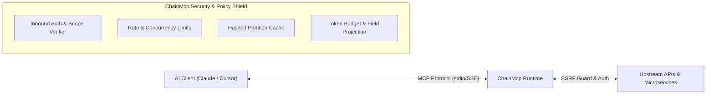

# ChainMcp

**Turn API contracts into Model Context Protocol (MCP) servers.**

ChainMcp
is an open-source TypeScript/Node.js toolkit that converts API contracts into MCP tools and provides a shared runtime for security, caching, token accounting, rate limiting, and observability.

## Vision

A developer provides an OpenAPI contract or writes a simple TypeScript tool. ChainMcp validates it, generates discoverable MCP tools, and makes them available through a standalone server or a dynamic gateway.

ChainMcp is more than an API-to-MCP code generator: it is an enterprise execution and policy layer for Model Context Protocol servers.



## Quick Start (Local Clone)

ChainMcp is not published to a package registry yet. Install it by cloning the
repository and linking generated projects to that checkout.

```bash
git clone https://github.com/chrisindark/chain-mcp.git
cd chain-mcp
pnpm install
pnpm build

# From the repository root, create a server project outside the workspace:
node packages/cli/dist/bin.js init \
  --spec ./examples/petstore/openapi.yaml \
  --output ~/my-mcp-server \
  --local-deps "$PWD"
```

`--local-deps` writes `file:` dependency specifiers and a
`pnpm-workspace.yaml` override block, so the generated project installs the
unpublished `@chainmcp/*` packages from the clone instead of a registry.

### Install, build, and run

```bash
cd ~/my-mcp-server
pnpm install
pnpm build
pnpm start        # stdio MCP server
```

### Connect to Claude Desktop or Your AI IDE

Add the server to your `claude_desktop_config.json`:

```json
{
  "mcpServers": {
    "my-api": {
      "command": "node",
      "args": ["/Users/you/my-mcp-server/dist/server.js"]
    }
  }
}
```

Open Claude Desktop or your AI IDE. Your API tools appear automatically in the tool inventory.

> [!NOTE]
> The `npx @chainmcp/cli ...` form shown in older guides requires published
> packages. Until publishing happens, run the CLI from the clone:
> `node packages/cli/dist/bin.js <command>`.
> Projects generated **inside** the monorepo can use `--workspace-deps` to keep
> `workspace:*` specifiers.

## Quick Start (Registry, after publishing)

This section is a preview of the published-package workflow. The
`@chainmcp/*` packages are not on a registry yet, so these commands do not work
until publishing happens; use the local-clone quick start above instead.

### 1. Initialize a Project from an API Spec

```bash
npx @chainmcp/cli init --spec ./openapi.yaml
# Or directly from an HTTPS URL:
npx @chainmcp/cli init --spec https://api.example.com/openapi.yaml
```

### 2. Validate and Build

```bash
npx @chainmcp/cli validate
npx @chainmcp/cli build
```

### 3. Connect to Claude Desktop or Your AI IDE

Install the CLI globally (`npm install -g @chainmcp/cli`), then use the same
`claude_desktop_config.json` entry shown above with `"command": "chainmcp"` and
`"args": ["serve"]`.

## Core capabilities

- **Contract compilation and execution:** OpenAPI 3.x to MCP tool definitions with bounded upstream HTTP.
- **Generated servers:** Portable projects that run independently.
- **Dynamic gateway:** Load and serve multiple versioned API contracts.
- **Token accounting:** Resource-bounded execution with token budgets; counts are labeled estimates unless an explicit `Tokenizer` is injected.
- **Smart caching:** TTLs, authorization-aware cache keys, and response projection.
- **Authentication:** Separate inbound MCP authorization from upstream API credentials.
- **Rate limiting:** Tenant, principal, and tool-level quotas.
- **Analytics:** Usage, latency, failures, cache performance, and token metrics.
- **JSON navigation:** Bounded pagination, path selection, shape inspection, and filtering of a JSON document supplied inline by the caller (no result handles).

## Product principles

1. Open-source core with no mandatory hosted dependency.
2. Generated and dynamic servers share the same runtime.
3. Security-sensitive behavior defaults to deny or bypass.
4. All network and resource consumption is bounded.
5. Every public capability has tests and documentation.
6. The project never claims an unimplemented capability is production-ready.

## Intended technology

- TypeScript and Node.js
- pnpm workspaces
- Official TypeScript MCP SDK
- Zod for runtime validation
- Node.js `http` for HTTP services
- Redis as an optional distributed cache and rate-limit backend
- The OpenTelemetry API for metrics and tracing (deployments bring their own
  exporter and SDK; no exporter or Prometheus endpoint is bundled)

These are initial architectural choices and may change through documented architecture decision records. PostgreSQL is not implemented and no database metadata store ships today; see `docs/limitations.md`.

## Repository documentation

- **`PRIORITIES.md`**: Active work queue for the local-first 1.0, ordered high to low priority (supersedes the retired remediation plan and raw triage).
- **`docs/product-guide.md`**: Complete plain-English product guide, visual architecture, metrics, caching, and adoption
- **`docs/README.md`**: Complete documentation index and topic map
- `ROADMAP.md`: historical milestone record and acceptance criteria
- `docs/getting-started.md`: runnable end-to-end example and Inspector commands
- `docs/declarative-tools.md`: versioned declarative HTTP tool descriptors and their execution guarantees
- `docs/declarative-admin.md`: self-hosted admin API and console for validating, previewing, and publishing descriptors
- `docs/supported-versions.md`: supported version matrix and lifecycle policy
- `docs/migration-and-rollback.md`: upgrade and rollback procedures
- `docs/troubleshooting.md`: error codes, diagnosis, and operational troubleshooting
- `ARCHITECTURE.md`: system design and component boundaries
- `CONFIGURATION.md`: configuration contract
- `DEVELOPMENT.md`: development and testing workflows
- `API_REFERENCE.md`: public interfaces and package contracts
- `SECURITY.md`: threat model and mandatory controls
- `RELEASES.md`: versioning and release process
- `CONTRIBUTING.md`: contribution workflow
- `AGENTS.md`: coding-agent instructions
- `examples/README.md`: runnable examples catalog and Claude Desktop setup

## Project status

ChainMcp is pre-1.0 (currently version `0.1.0`). Milestones 0–9 are implemented and covered by the repository's test suite, but the **1.0 release is deliberately withheld**: `RELEASES.md` records release gates that are not yet complete, including long-running and production-traffic validation. Do not treat this repository as a 1.0 release.

The repository contains 15 workspace packages:

- `@chainmcp/core`: in-memory tool registry, linear-time Re2 regex validation, output projection, token budgets, and cached execution.
- `@chainmcp/config`: strict Zod configuration loader for `chainmcp.config.yaml` and `gateway.config.yaml`.
- `@chainmcp/compiler`: OpenAPI 3.0/3.1 contract parser, deterministic manifests, and tool lowering.
- `@chainmcp/authoring`: code-first tool authoring facade (`defineTool`) with Zod lowering.
- `@chainmcp/declarative`: versioned declarative HTTP descriptors validated and executed through the bounded executor.
- `@chainmcp/admin`: self-hosted, tenant-scoped admin API and console for validating, previewing, publishing, persisting, restoring, and rolling back descriptors through the dynamic gateway.
- `@chainmcp/auth`: inbound caller authorization, operation scope verification, encrypted secret storage, and OAuth 2.0 client credentials.
- `@chainmcp/executor`: outbound HTTP execution with strict SSRF defense, DNS pinning, private range blocking, and response byte caps.
- `@chainmcp/rate-limit`: quota and concurrency rate limiters with in-memory and Redis backends.
- `@chainmcp/cache-redis`: distributed Redis cache store adapter.
- `@chainmcp/analytics`: structured logging with automatic secret redaction, OpenTelemetry metrics/tracing, and sliding-window aggregation.
- `@chainmcp/json-navigation`: bounded JSON pagination, slicing, and inspection tools for LLMs.
- `@chainmcp/server`: official TypeScript MCP SDK server adapter (stdio and HTTP/SSE).
- `@chainmcp/gateway`: multi-tenant dynamic gateway with atomic contract revisions and rollback.
- `@chainmcp/cli`: developer CLI commands for scaffolding, building, diffing, and serving.

Run `pnpm install` followed by `pnpm check` from the repository root to run formatting, linting, custom ESLint blocking-I/O rules, package builds, type checking, unit tests, resilience tests, and SBOM checks.

## CLI commands

```bash
chainmcp init --spec ./openapi.yaml  # Scaffolds project from API spec (or HTTPS URL)
chainmcp init --spec ./openapi.yaml --local-deps /path/to/chain-mcp  # Link unpublished packages from a clone
chainmcp validate                    # Audits schemas, regexes, and URLs
chainmcp build                       # Compiles tools and manifests
chainmcp diff --against baseline.yaml # Detects schema drift and breaking changes
chainmcp serve                       # Starts the local MCP server (stdio by default)
chainmcp serve --transport http --port 3333 # Serves Streamable HTTP / SSE endpoint
chainmcp dev                         # Fast authoring loop; loads dist/tools.js or src/tools.ts
chainmcp gateway serve               # Starts dynamic multi-contract gateway server
chainmcp export --output ./dist-srv --local-deps /path/to/chain-mcp  # Exports a portable standalone server
chainmcp config explain              # Prints resolved config with secrets redacted
```

These examples assume `chainmcp` is installed (or linked) and on `PATH`. From a
fresh clone without a global install, run the CLI as
`node packages/cli/dist/bin.js <command>` instead.

> [!NOTE]
> Credential fields in `chainmcp.config.yaml` accept `${VAR}` and
> `${VAR:-default}` references. A missing variable stops startup with
> `SECRET_UNRESOLVED` naming the field and variable, and resolved values are
> never logged. See `CONFIGURATION.md` for the supported fields.

> [!NOTE]
> When authoring TypeScript code-first tools (`src/tools.ts`), `chainmcp dev` automatically loads TypeScript files when executed under `tsx` (e.g. `npx tsx packages/cli/dist/bin.js dev` from a clone) or when precompiled (`chainmcp build` / `tsc`).

## Transports and Inbound Authentication

ChainMcp supports both standard MCP transport protocols:

- **Stdio (`--transport stdio`):** Standard input/output for local desktop clients such as Claude Desktop and Cursor.
- **Streamable HTTP (`--transport http`):** Modern HTTP/SSE server endpoint for containerized and remote deployments. Includes health probes (`/health`), opt-in CORS with an explicit origin allowlist (disabled by default, and non-allowlisted browser origins are rejected), and drain-then-cancel signal teardown (late requests get `503`; in-flight calls drain for up to `server.shutdownTimeoutMs`).

When running over HTTP, configure inbound caller authentication via `chainmcp.config.yaml`:

- **Bearer Tokens:** Static or dynamic token verifiers mapping tokens to tenant ID, principal ID, and scopes.
- **API Keys:** Header-based API key verifiers (e.g. `X-API-Key`).
- **JSON Web Tokens (JWT):** Signed HS256/RS256/ES256 token verification with standard claims (`exp`, `nbf`, `iss`, `aud`) validated via standard crypto without external runtime dependencies.
- Inbound identity is automatically propagated to runtime `ToolContext` and MCP `AuthInfo` for per-call authorization and rate limiting.

## Security

Do not expose an unreviewed instance to untrusted traffic. Read `SECURITY.md` before implementing upstream HTTP execution, remote transports, credentials, or caching.

## License

ChainMcp is licensed under the [Apache License, Version 2.0](LICENSE).
