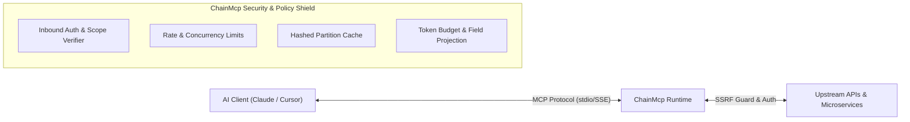

# ChainMcp

**Turn API contracts into production-ready Model Context Protocol (MCP) servers.**

ChainMcp
is an open-source TypeScript/Node.js toolkit that converts API contracts into MCP tools and provides a shared runtime for security, caching, token accounting, rate limiting, and observability.

## Vision

A developer provides an OpenAPI contract or writes a simple TypeScript tool. ChainMcp validates it, generates discoverable MCP tools, and makes them available through a standalone server or a dynamic gateway.

ChainMcp is more than an API-to-MCP code generator: it is an enterprise execution and policy layer for Model Context Protocol servers.



## Quick Start (From 0 to MCP in 3 Steps)

### 1. Initialize a Project from an API Spec

```bash
npx chainmcp init --spec ./openapi.yaml
```

### 2. Validate and Build

```bash
chainmcp validate
chainmcp build
```

### 3. Connect to Claude Desktop or Your AI IDE

Add the server to your `claude_desktop_config.json`:

```json
{
  "mcpServers": {
    "my-api": {
      "command": "chainmcp",
      "args": ["serve"]
    }
  }
}
```

Open Claude Desktop or your AI IDE. Your API tools appear automatically in the tool inventory!

## Core capabilities

- **Contract compilation and execution:** OpenAPI 3.x to MCP tool definitions with bounded upstream HTTP.
- **Generated servers:** Portable projects that run independently.
- **Dynamic gateway:** Load and serve multiple versioned API contracts.
- **Token accounting:** Token counts or explicitly labeled estimates.
- **Smart caching:** TTLs, authorization-aware cache keys, and response projection.
- **Authentication:** Separate inbound MCP authorization from upstream API credentials.
- **Rate limiting:** Tenant, principal, and tool-level quotas.
- **Analytics:** Usage, latency, failures, cache performance, and token metrics.
- **JSON navigation:** Bounded exploration of large JSON responses.

## Product principles

1. Open-source core with no mandatory hosted dependency.
2. Generated and dynamic servers share the same runtime.
3. Security-sensitive behavior defaults to deny or bypass.
4. All network and resource consumption is bounded.
5. Every public capability has tests and documentation.
6. The project never claims an unimplemented capability is production-ready.

## Intended technology

- TypeScript and Node.js
- pnpm workspaces
- Official TypeScript MCP SDK
- Zod for runtime validation
- Hono for HTTP services where appropriate
- Redis as an optional distributed cache
- PostgreSQL as an optional metadata store
- OpenTelemetry for observability

These are initial architectural choices and may change through documented architecture decision records.

## Repository documentation

- `ROADMAP.md`: milestones and acceptance criteria
- `docs/getting-started.md`: runnable end-to-end example and Inspector commands
- `docs/supported-versions.md`: supported version matrix and lifecycle policy
- `docs/migration-and-rollback.md`: upgrade and rollback procedures
- `docs/troubleshooting.md`: error codes, diagnosis, and operational troubleshooting
- `ARCHITECTURE.md`: system design and component boundaries
- `CONFIGURATION.md`: configuration contract
- `DEVELOPMENT.md`: development and testing workflows
- `API_REFERENCE.md`: public interfaces and package contracts
- `SECURITY.md`: threat model and mandatory controls
- `RELEASES.md`: versioning and release process
- `CONTRIBUTING.md`: contribution workflow
- `AGENTS.md`: coding-agent instructions
- `docs/`: detailed product and implementation guides

## Project status

ChainMcp has achieved its **1.0 Stable Release** milestone, satisfying all release gates in `RELEASES.md`.

The repository contains 13 fully verified workspace packages:

- `@chainmcp/core`: in-memory tool registry, linear-time Re2 regex validation, output projection, token budgets, and cached execution.
- `@chainmcp/config`: strict Zod configuration loader for `chainmcp.config.yaml`.
- `@chainmcp/compiler`: OpenAPI 3.0/3.1 contract parser, deterministic manifests, and tool lowering.
- `@chainmcp/authoring`: code-first tool authoring facade (`defineTool`) with Zod lowering.
- `@chainmcp/auth`: inbound caller authorization, operation scope verification, encrypted secret storage, and OAuth 2.0 client credentials.
- `@chainmcp/executor`: outbound HTTP execution with strict SSRF defense, DNS pinning, private range blocking, and response byte caps.
- `@chainmcp/rate-limit`: quota and concurrency rate limiters with in-memory and Redis backends.
- `@chainmcp/cache-redis`: distributed Redis cache store adapter.
- `@chainmcp/analytics`: structured logging with automatic secret redaction, OpenTelemetry metrics/tracing, and sliding-window aggregation.
- `@chainmcp/json-navigation`: bounded JSON pagination, slicing, and inspection tools for LLMs.
- `@chainmcp/server`: official TypeScript MCP SDK server adapter (stdio and HTTP/SSE).
- `@chainmcp/gateway`: multi-tenant dynamic gateway with atomic contract revisions and rollback.
- `@chainmcp/cli`: developer CLI commands for scaffolding, building, diffing, and serving.

Run `pnpm install` followed by `pnpm check` from the repository root to run formatting, linting, custom ESLint blocking-I/O rules, package builds, type checking, unit tests, resilience tests, and SBOM checks.

## CLI commands

```bash
chainmcp init --spec ./openapi.yaml  # Scaffolds project from API spec
chainmcp validate                    # Audits schemas, regexes, and URLs
chainmcp build                       # Compiles tools and manifests
chainmcp serve                       # Starts the local MCP server
chainmcp export --output ./dist-srv  # Exports portable standalone server
chainmcp diff                        # Detects schema drift and breaking changes
```

## Security

Do not expose an unreviewed instance to untrusted traffic. Read `SECURITY.md` before implementing upstream HTTP execution, remote transports, credentials, or caching.

## License

ChainMcp is licensed under the [Apache License, Version 2.0](LICENSE).
