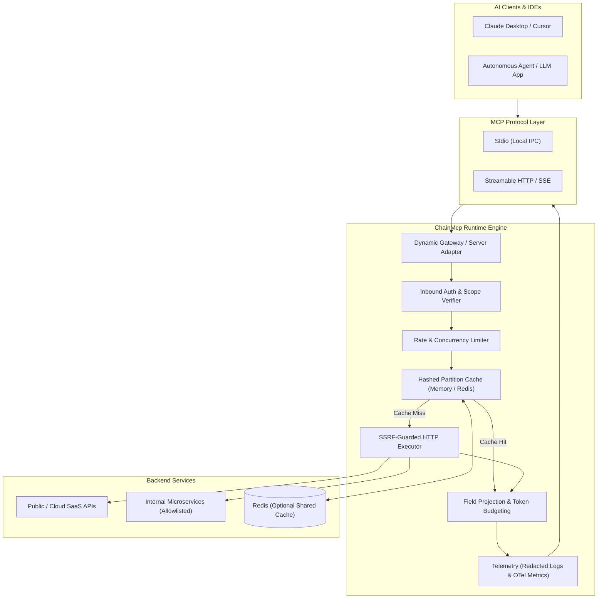
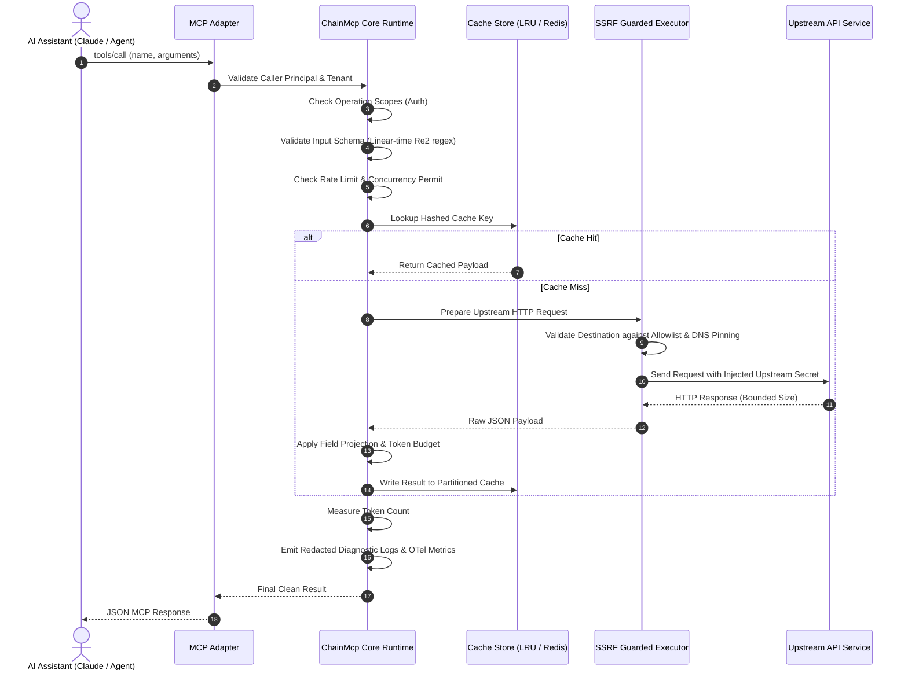
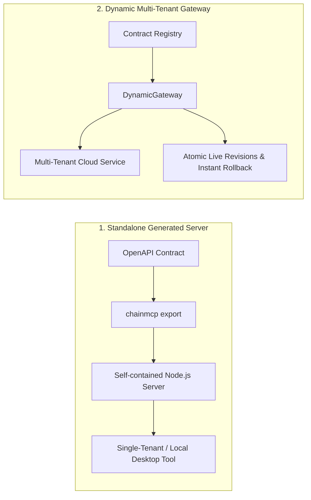

# ChainMcp — Complete Product, Architecture & Adoption Guide

> [!NOTE]
> This guide is designed for developers, engineering managers, and product leads who want a clear, comprehensive understanding of ChainMcp: what it does, why it exists, how the architecture works, its production capabilities, and how to adopt it easily without needing deep compiler expertise.

---

## 1. What is ChainMcp in Plain English?

**ChainMcp is a secure translation gateway and execution fortress between AI Models (Claude, ChatGPT, Gemini, local LLMs) and your existing APIs.**

Instead of hand-coding messy integration scripts or giving an AI agent direct, unrestricted HTTP access to your servers, ChainMcp:

1. **Ingests your existing API specs** (OpenAPI 3.0 / 3.1 YAML/JSON) or simple TypeScript functions.
2. **Transforms them into standard MCP Tools** that AI assistants can instantly discover and call.
3. **Protects your infrastructure** with an enterprise security and policy layer:
   - **Stops Prompt Flooding:** Filters out massive JSON responses, trimming data to only what the LLM actually requested so you don't burn tokens or exceed context windows.
   - **Blocks SSRF & Hack Attacks:** Prevents prompt-injected LLMs from probing your AWS metadata endpoints (`169.254.169.254`), local network, or internal databases.
   - **Prevents Credential Leaks:** Separates user identities from backend API keys. The AI never sees your real database or API passwords.
   - **Saves Money via Smart Caching:** Deduplicates identical API queries while strictly respecting user permissions (User A never sees cached data belonging to User B).
   - **Enforces Quotas & Rate Limits:** Prevents runaway agent loops from overwhelming upstream services.

---

## 2. Before vs. After ChainMcp

| Challenge                   | Without ChainMcp (Direct API Access)                                                                                      | With ChainMcp                                                                                                                   |
| :-------------------------- | :------------------------------------------------------------------------------------------------------------------------ | :------------------------------------------------------------------------------------------------------------------------------ |
| **Context Window Overload** | An API returns 500 records (100,000 JSON lines). The LLM context window crashes or bills you \$5 per prompt.              | Built-in field projection and token budgets reduce payloads by up to 90%, returning only requested fields.                      |
| **Security & SSRF**         | An attacker prompts the model to call `http://169.254.169.254` or `http://localhost:5432`. Cloud credentials get exposed. | Strict outbound policy engine enforces DNS pinning and blocks loopback, private, and metadata IP addresses.                     |
| **Credential Safety**       | The AI or client app holds the master API token. One prompt extraction reveals backend keys.                              | Inbound MCP caller tokens are verified independently from upstream API credentials. Secrets are automatically redacted in logs. |
| **Cost & Latency**          | Every question re-runs expensive database queries and third-party APIs.                                                   | Hashed, authorization-aware caching (in-memory or Redis) returns instant sub-millisecond responses safely.                      |
| **Multi-Tenancy**           | Different enterprise customers or users collide or accidentally see each other's data.                                    | Native multi-tenant isolation: tenants only see their assigned tools, contracts, and cache partitions.                          |

---

## 3. Visual System Architecture

### 3.1 Bird's-Eye View



---

### 3.2 Invocation Lifecycle (Sequence Diagram)

When an AI model decides to call a tool, here is the exact 15-step deterministic lifecycle it follows:



---

### 3.3 Two Delivery Modes

ChainMcp provides two deployment models using the exact same underlying execution engine:



1. **Standalone Generated Server:** Compile a single API contract into a standalone, portable TypeScript project. Ideal for local desktop tools, CLI wrappers, or single-purpose microservice containers.
2. **Dynamic Multi-Tenant Gateway:** Run a central server that loads dozens of API contracts dynamically. Different corporate tenants have isolated tools, quotas, and cache keys with zero-downtime hot reloads and instant rollback.

---

## 4. Package Map: What Each Part Does

ChainMcp is organized into 13 modular workspace packages:

| Package                         | Purpose in One Sentence                                                                                                          |
| :------------------------------ | :------------------------------------------------------------------------------------------------------------------------------- |
| **`@chainmcp/core`**            | The brain: handles tool registry, input validation, execution timeouts, cancellation, token measurement, and caching interfaces. |
| **`@chainmcp/compiler`**        | Reads OpenAPI 3.0/3.1 specs and compiles them into deterministic tool definitions with linear-time regex audits.                 |
| **`@chainmcp/authoring`**       | Lets you write tools directly in TypeScript with Zod schemas instead of needing an OpenAPI file.                                 |
| **`@chainmcp/executor`**        | Outbound HTTP client with military-grade SSRF defense, DNS pinning, redirect limits, and response byte caps.                     |
| **`@chainmcp/server`**          | Wraps the official Model Context Protocol (MCP) SDK v2 for stdio and HTTP/SSE transports.                                        |
| **`@chainmcp/gateway`**         | Central multi-tenant hub for dynamically publishing, versioning, isolating, and rolling back contracts.                          |
| **`@chainmcp/auth`**            | Maps caller identity to permissions and injects upstream credentials (OAuth 2.0 Client Credentials, API keys, Bearer tokens).    |
| **`@chainmcp/rate-limit`**      | Token-bucket quotas (requests/min) and concurrency limiters with in-memory and Redis backends.                                   |
| **`@chainmcp/cache-redis`**     | Optional Redis adapter for persistent, distributed response caching.                                                             |
| **`@chainmcp/analytics`**       | Redacted structured logging, OpenTelemetry metrics, tracing, and sliding-window operational summaries.                           |
| **`@chainmcp/json-navigation`** | AI helper tools that allow LLMs to paginate, slice, and query large JSON datasets without loading the whole file into context.   |
| **`@chainmcp/config`**          | Validates `chainmcp.config.yaml` using strict Zod schemas.                                                                       |
| **`@chainmcp/cli`**             | Command-line tool (`chainmcp init`, `validate`, `build`, `serve`, `export`, `diff`).                                             |

---

## 5. What are ChainMcp's Limitations? (Honest Truth)

To ensure smooth adoption, understand what ChainMcp is **not**:

- **Not an Agent Framework:** ChainMcp does not prompt LLMs or decide which tool to call. It is the tool execution layer used by Claude, OpenAI Assistants, LangChain, CrewAI, AutoGen, or Cursor.
- **JSON Payloads Only in 1.0:** File uploads (multipart/form-data) and raw binary streams (audio/video generation chunks) are not supported in 1.0. Responses must be JSON.
- **SSRF Guard Blocks Localhost by Default:** You cannot point ChainMcp in production to `http://localhost:8080` or `127.0.0.1`. It strictly demands public, allowlisted hostnames. (In tests or development, use mock transports or explicit flags).
- **No Hosted Cloud Dashboard Yet:** ChainMcp is 100% self-hosted open-source software. There is no hosted web UI control plane; administration is done via YAML files, CLI commands, or TypeScript gateway APIs.
- **Stateless Tool Invocations:** The runtime does not store intermediate conversational state between tool calls; state lives in your AI agent.

---

## 6. Observability, Monitoring & Metrics

ChainMcp comes with built-in instrumentation designed for enterprise monitoring platforms (Datadog, Prometheus, Grafana, OpenTelemetry).

### 6.1 Safe Structured Logging

Logs are emitted in JSON format with **automatic secret redaction**:

- Headers like `Authorization`, `Cookie`, `X-API-Key` are automatically masked as `[REDACTED]`.
- API keys matching common high-entropy patterns are masked.
- Upstream request/response bodies are not logged by default, preventing sensitive customer PII from leaking into log aggregators.

```json
{
  "level": "info",
  "message": "Tool 'getPets' completed successfully",
  "timestamp": 1729944000000,
  "context": {
    "requestId": "req-9841",
    "tenantId": "acme-corp",
    "toolName": "getPets",
    "contractRevision": "rev-e3b0c44",
    "durationMs": 42,
    "outcome": "success",
    "cacheOutcome": "hit"
  }
}
```

### 6.2 The Top 6 Metrics to Monitor

Wire `@chainmcp/analytics` into your Prometheus or OpenTelemetry Collector. Track these 6 gauges/counters:

```
┌──────────────────────────────────────┬─────────────┬─────────────────────────────────────────────────┐
│ Metric Name                          │ Type        │ What it Tells You                               │
├──────────────────────────────────────┼─────────────┼─────────────────────────────────────────────────┤
│ chainmcp.tool_invocations.total      │ Counter     │ Tool throughput broken down by toolName,        │
│                                      │             │ tenantId, and outcome (success/error).          │
│ chainmcp.tool_duration_ms            │ Histogram   │ Invocation latency (p50, p95, p99).             │
│ chainmcp.cache.ratio                 │ Gauge       │ Cache efficiency (hits / [hits + misses]).      │
│ chainmcp.tokens.measured             │ Counter     │ Total LLM tokens consumed vs tokens saved by    │
│                                      │             │ field projection.                               │
│ chainmcp.rate_limit.denials          │ Counter     │ How often callers are throttled with 429        │
│                                      │             │ (helps identify noisy agents or quota limits).  │
│ chainmcp.upstream_failures           │ Counter     │ Backend API health (5xx errors, socket aborts). │
└──────────────────────────────────────┴─────────────┴─────────────────────────────────────────────────┘
```

### 6.3 Recommended Alerts

- **High Error Rate Alert:** Trigger when `outcome == "error"` exceeds 2% over a 5-minute window.
- **Upstream Latency Spike Alert:** Trigger when `durationMs.p95` exceeds 2,500ms.
- **Cache Eviction Warning:** Trigger when Redis cache memory exceeds 80% of maxmemory.

---

## 7. Caching & Database Tracking Strategy

### 7.1 How Caching Works (and Why It's Safe)

In normal API caching, caching user-sensitive endpoints causes privacy leaks (User A sees User B's account balance).

ChainMcp solves this with **Versioned, Hashed, Partitioned Keys**:

```text
Cache Key = Hash(ContractRevision + ToolName + NormalizedInput + AuthorizationPartition)
```

- **Authorization Partition:** A non-secret string derived from the user's effective scopes/roles. If two users have different permissions, their cache keys never collide.
- **Contract Revision:** If the API specification changes, the cache key automatically invalidates, preventing stale data after schema updates.
- **Bounded Size:** In-memory cache limits both entry counts and memory footprint (default 16 MiB) with least-recently-used (LRU) eviction. For multi-instance scaling, plug in `@chainmcp/cache-redis`.

### 7.2 Database & Audit Tracking

If your security team or compliance (SOC2 / HIPAA / ISO27001) requires tracking every tool call to a database (e.g. PostgreSQL, ClickHouse):

- Implement the `MetricsSink` or `Logger.audit` interface.
- Store the immutable audit record:
  ```ts
  interface AuditEvent {
    timestamp: Date;
    tenantId: string;
    principalId: string;
    toolName: string;
    contractRevision: string;
    outcome: "success" | "rate_limited" | "error";
    durationMs: number;
  }
  ```
- Because ChainMcp separates audit logs from raw payload execution, you get a clean compliance audit trail with zero secret leakage.

---

## 8. Non-Technical Quickstart: How Anyone Can Adopt ChainMcp

You do not need to write complex code to use ChainMcp. Here is the 3-step path to turn any OpenAPI spec into an AI-ready MCP server.

### Step 1: Initialize the Project

Open your terminal in any directory and run:

```bash
npx chainmcp init --spec https://petstore.swagger.io/v2/swagger.json
```

This inspects your API, creates an audited tool definition, and creates a clean `chainmcp.config.yaml`.

### Step 2: Build & Verify

```bash
chainmcp validate
chainmcp build
```

ChainMcp verifies that all URLs are safe, all regular expressions are immune to ReDoS attacks, and that all inputs are bounded.

### Step 3: Connect to Your AI Assistant (Claude, Cursor, etc.)

Add the generated server to your `claude_desktop_config.json` or Cursor settings:

```json
{
  "mcpServers": {
    "my-api": {
      "command": "node",
      "args": ["/path/to/your-project/dist/server.js"]
    }
  }
}
```

Open Claude Desktop or your AI IDE. Your API tools immediately appear in the tool menu, fully typed, secured, and ready for prompts!
